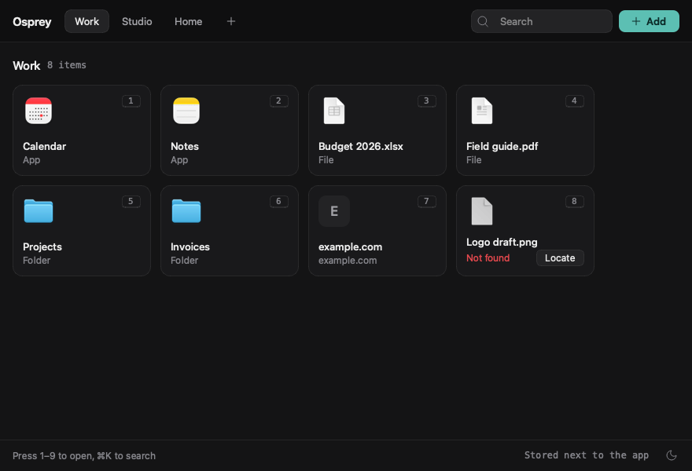

# Osprey Launcher

Osprey Launcher keeps your apps, shortcuts, files, folders and web links in one window. Group them in tabs. Open any item with one click or one key.

Works offline. Sends no data. The one exception is a single request for a site's icon when you add a link.



## Features

- Tabs to group items, for example Work, Studio and Home
- Add items by drag and drop, or with the **Add** button
- Drag tiles to reorder them, or onto another tab to move them
- Real system icons for apps, files and folders. Site icons for links
- Show or hide the name and type under each icon
- Star items to keep them together in a Starred tab
- Give items your own names
- A readable backup of all tabs and items, saved after every change
- Keys 1 to 9 open the first nine items in the tab
- Search across all tabs
- Light and dark themes, or follow the system theme
- Portable: all data stays in one folder next to the app

## Download

Osprey Launcher will be published for Windows (x64), macOS (Apple silicon) and Linux (x64) on the [Releases page](https://github.com/TariqMK/Osprey-Launcher/releases).

**Note:** No release is published yet. To use the app now, see [Run from source](#run-from-source).

**Note:** macOS builds will be unsigned. The first time you open the app, macOS blocks it. To allow it:

1. Open **System Settings** > **Privacy & Security**.
2. Scroll to **Security**.
3. Select **Open Anyway** next to the Osprey Launcher message.

## Use the app

### Add items

Drag one or more files, folders, apps, shortcuts or links from your file manager or browser into the window. The items go into the open tab.

To add items to a different tab, drop them on that tab's name. The tab name gets an outline before you release. The open tab does not change.

To add items with the **Add** button:

1. Select **Add**.
2. Select one of these:
   - **Files or apps…** to choose one or more files or apps.
   - **Folder…** to choose a folder.
   - **Link…** to type a web address.

**Note:** An item that is already in the tab is not added again.

### Open items

- Click a tile to open it.
- Press **1** to **9** to open the item with that number on its tile.

Files open in their default app. Folders open in your file manager. Links open in your default browser.

### Arrange items

To change the order of tiles in a tab:

1. Drag a tile.
2. Release it when a line shows in the gap where you want it.

To move a tile to another tab:

1. Drag the tile onto the name of the other tab. The tab name gets an outline.
2. Release the tile. It goes to the end of that tab.

**Note:** You cannot reorder tiles while a search is open. You can still drag a search result onto a tab to move it.

The order is saved at once. Keys 1 to 9 follow the new order.

### Star items

Starred items show in a **Starred** tab. This tab shows first, and only while at least one item is starred.

To star an item, do one of these:

- Right-click the tile and select **Add to Starred**.
- Drag the tile onto the **Starred** tab.

A starred tile shows a small star next to its number. In the **Starred** tab, each tile shows the name of its own tab.

**Note:** A starred item stays in its own tab. The **Starred** tab shows the same item, not a copy.

To remove the star, right-click the tile and select **Remove from Starred**. When no items are starred, the **Starred** tab closes.

To change the order in the **Starred** tab, drag the tiles. The order in their own tabs does not change.

Items you drop or add while the **Starred** tab is open go into your first tab and get a star.

### Manage items

Right-click a tile to see these commands:

| Command | Result |
| --- | --- |
| **Open** | Opens the item. |
| **Show in Finder** / **Show in File Explorer** / **Show in folder** | Shows the item in your file manager. |
| **Copy path** / **Copy link** | Copies the location to the clipboard. |
| **Locate…** | Points the tile at the item's new location. |
| **Download site icon** | Tries again to get the icon for a link. Shown only for links that have no icon. |
| **Rename…** | Gives the tile your own name. The original name is kept. The file is not renamed. |
| **Reset name to "…"** | Goes back to the original name. Shown only after a rename. |
| **Move to** | Moves the tile to another tab. |
| **Add to Starred** / **Remove from Starred** | Adds or removes the star. |
| **Remove from launcher** | Removes the tile. The file, folder or app is not changed. |

### Back up and restore

After every change, Osprey Launcher saves a readable backup of all tabs and items. The backup is `osprey-backup.yaml` in the `OspreyLauncher-data` folder next to the app.

The backup holds, for each tab and item:

- Tab name and position
- Item position, original name, custom name and type
- Full path of the file, folder or app, or the web link
- Whether the item is starred, and its position in the **Starred** tab

To open the folder that holds the backup:

1. Select **Stored next to the app** at the bottom of the window.
2. Select **Open data folder**.

To restore from a backup:

1. Select **Stored next to the app** at the bottom of the window.
2. Select **Restore from backup…**.
3. Choose the backup file. It can be `osprey-backup.yaml` or a copy of it.
4. Select **Restore**.

**Caution:** Restore replaces all tabs and items in the launcher. Your files, folders and apps are not changed.

You can edit the backup in a text editor, for example to change names or positions. The comments at the top of the file explain each field.

**Caution:** The next change in the app overwrites `osprey-backup.yaml`. Restore your edits before you make other changes, or edit a copy and restore the copy.

If the launcher data file is damaged, Osprey Launcher loads the backup when it starts and shows a message. The damaged file is kept in the data folder.

### Fix a moved or deleted item

If a file or folder is moved or deleted, its tile shows **Not found**. When the type line is hidden, the name shows in red. When only icons are shown, a red dot shows in the corner of the tile.

1. Select the tile, or select **Locate** on the tile.
2. Choose the item's new location.

### Manage tabs

- To add a tab, select **+** next to the tabs and type a name.
- To rename a tab, right-click it and select **Rename…**.
- To delete a tab, right-click it and select **Delete tab…**. Then select **Delete**.

**Note:** Deleting a tab removes its tiles from the launcher only. Your files, folders and apps are not changed. The last tab cannot be deleted.

### Search

1. Press **⌘K** on macOS or **Ctrl+K** on Windows and Linux.
2. Type part of an item's name, file name or web address. Results come from all tabs.
3. Press **Enter** to open the first result, or press **1** to **9** after you leave the search field.
4. Press **Esc** to clear the search.

### Show or hide tile labels

Each tile shows the item name and its type under the icon. To hide one or both:

1. Select the grid button at the bottom right of the window.
2. Select **Show names** or **Show types** to turn it on or off.

Tiles get smaller when a label is hidden. With both labels off, only icons show. The setting applies to all tabs and is saved.

**Note:** To see an item's full name and location, hold the pointer over its tile.

### Change the theme

Select the theme button at the bottom right of the window. Each click changes the theme in this order: **System**, **Light**, **Dark**.

## Privacy

- The app works offline. All features except site icons work with no internet connection.
- The app has no telemetry, analytics, crash reporting or tracking.
- No account is needed.
- All data is stored in the `OspreyLauncher-data` folder next to the app. On macOS this folder is next to `Osprey Launcher.app`. Move the app and this folder together to keep your tabs and items.
- The folder holds `launcher.json` (tabs, items and settings), `osprey-backup.yaml` (the readable backup) and `icons/` (saved site icons). The backup lists the full paths of your items. Keep this in mind before you share it.
- The app makes one kind of network connection. When you add a link, it requests the site's icon from that site only (`/apple-touch-icon.png`, then `/favicon.ico`). It sends a normal web request with no personal data. The icon is saved in `OspreyLauncher-data/icons` and is not downloaded again.
- Opening a link opens it in your own browser. The app does not contact the site for this.

## Run from source

Requires Python 3.9 or later.

1. Clone the repository:
   ```bash
   git clone https://github.com/TariqMK/Osprey-Launcher.git
   ```
2. Go to the project folder:
   ```bash
   cd Osprey-Launcher
   ```
3. Create a virtual environment:
   ```bash
   python3 -m venv .venv
   ```
4. Install the app and the development tools:
   ```bash
   .venv/bin/pip install -e ".[dev]"
   ```
   On Windows, use `.venv\Scripts\pip` instead of `.venv/bin/pip`.
5. Start the app:
   ```bash
   .venv/bin/python -m osprey_launcher
   ```

When run from source, the data folder is `OspreyLauncher-data` in the project folder.

**Note:** On Linux, `.desktop` shortcuts open with `gio launch`. Install GLib if `gio` is not available.

## Tests

Run all tests:

```bash
.venv/bin/python -m pytest
```

Check code style:

```bash
.venv/bin/ruff check .
```

## Licence

Osprey Launcher is licensed under the [GNU General Public License v3.0](LICENSE).

Interface icons are from [Lucide](https://lucide.dev) (ISC licence).
