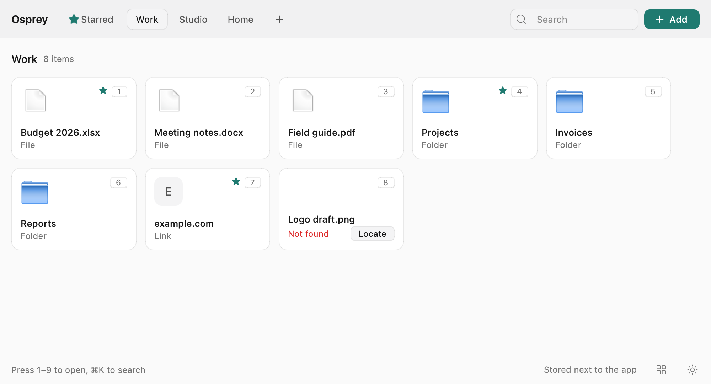
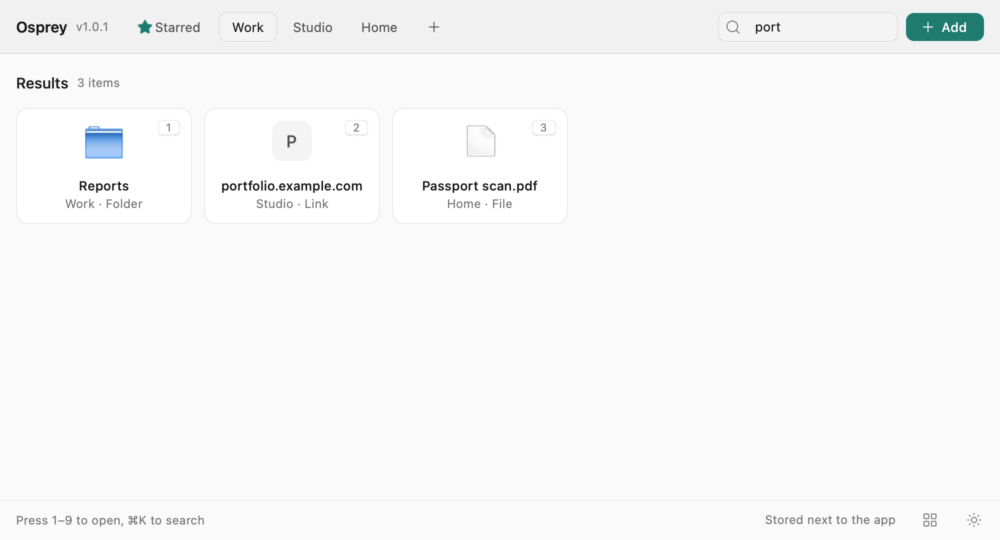
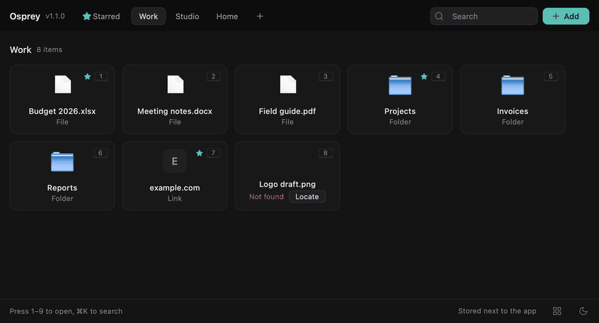
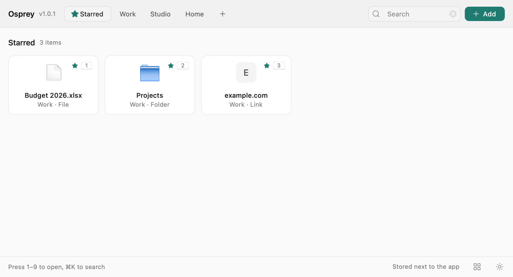
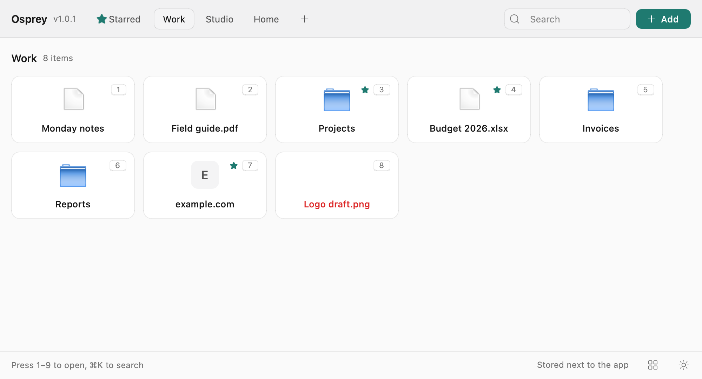
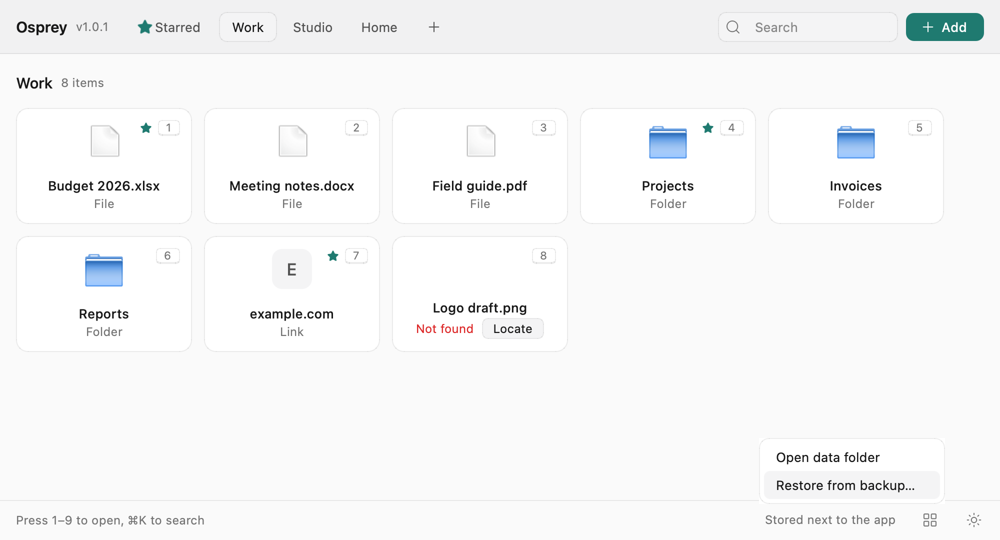
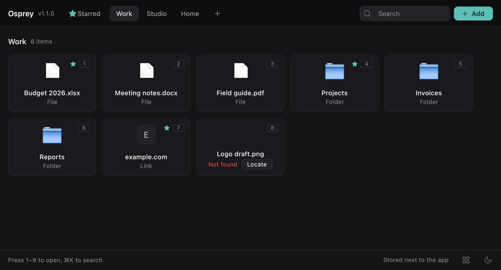

Open any app, file, folder or web link from one tabbed window, with one click or one key. Works offline. No tracking.

**Contents:** [What it does](#what-it-does) · [Privacy](#privacy) · [Download](#download) · [How to use](#how-to-use) · [For developers](#for-developers)

<picture>
  <source media="(prefers-color-scheme: dark)" srcset="assets/screenshots/main-dark.png">
  
</picture>

## What it does

Osprey Launcher holds the apps, shortcuts, files, folders and web links you use every day. Group them in tabs, for example Work, Studio and Home. Each item shows as a tile with its real icon and a number.

Press 1 to 9 to open the first nine items in the open tab, or click a tile. Files open in their default app, folders in your file manager and links in your browser.

### Find anything in a second

<picture>
  <source media="(prefers-color-scheme: dark)" srcset="assets/screenshots/search-dark.png">
  
</picture>

Search looks through every tab at once. Press Enter to open the first result.

### Drag in, drag around



Drop files, folders, apps or links into the window to add them. Drag a tile to change the order, or onto another tab to move it.

### Your favourites in one place

<picture>
  <source media="(prefers-color-scheme: dark)" srcset="assets/screenshots/starred-dark.png">
  
</picture>

Star an item and it also shows in the **Starred** tab. It stays in its own tab too.

### Your names, your layout

<picture>
  <source media="(prefers-color-scheme: dark)" srcset="assets/screenshots/labels-dark.png">
  
</picture>

Give any tile your own name. Hide the names or types under the icons to fit more tiles in the window.

### Your data stays with the app

<picture>
  <source media="(prefers-color-scheme: dark)" srcset="assets/screenshots/data-menu-dark.png">
  
</picture>

All data stays in one folder next to the app. Copy the app and the folder to another drive or computer, and your tabs come with it.

After every change, the app also saves all tabs and items to a plain text backup. Restore from it at any time, or edit it by hand.

### Light or dark

 

Use the light theme, the dark theme, or follow your system setting.

## Privacy

- The app works offline. All features except site icons work with no internet connection.
- The app has no telemetry, analytics, crash reporting or tracking.
- No account is needed.
- All data is stored in the `OspreyLauncher-data` folder next to the app. On macOS this folder is next to `Osprey Launcher.app`. Move the app and this folder together to keep your tabs and items.
- The folder holds `launcher.json` (tabs, items and settings), `osprey-backup.yaml` (the readable backup) and `icons/` (saved site icons). The backup lists the full paths of your items. Keep this in mind before you share it.
- The app makes one kind of network connection. When you add a link, it requests the site's icon from that site (`/apple-touch-icon.png`, then `/favicon.ico`). If the site redirects the request to another secure (HTTPS) address, the app follows it. It sends a normal web request with no personal data. The icon is saved in `OspreyLauncher-data/icons` and is not downloaded again.
- Opening a link opens it in your own browser. The app does not contact the site for this.

## Download

Download the latest version from the [Releases page](https://github.com/TariqMK/Osprey-Launcher/releases/latest), or from the [Osprey Launcher website](https://tariqmk.github.io/Osprey-Launcher/).

Osprey Launcher runs on Windows (x64), macOS on Apple silicon (M1 or later) and Linux (x64).

| System | File | Contents |
| --- | --- | --- |
| Windows (x64) | `Osprey-Launcher-vX.Y.Z-windows-x64.exe` | The app, as one file. No installer. |
| macOS (Apple silicon) | `Osprey-Launcher-vX.Y.Z-macos-arm64.zip` | `Osprey Launcher.app`. |
| Linux (x64) | `Osprey-Launcher-vX.Y.Z-linux-x64.tar.gz` | The `osprey-launcher` program, as one file. |

1. Download the file for your system.
2. On macOS, open the `.zip` file to get `Osprey Launcher.app`. On Linux, extract the `.tar.gz` file to get the `osprey-launcher` program.
3. Put the app in a folder of your choice. The app creates its data folder next to itself.
4. Open the app.

The version shows next to the name at the top left of the window.

### Opening on macOS

Osprey Launcher isn't notarised by Apple, so macOS shows a warning the first time you open it. This is expected and doesn't mean the app is harmful.

1. Open Osprey Launcher and click **Done** on the warning.
2. Open **System Settings → Privacy & Security**, scroll down to the message saying "Osprey Launcher" was blocked, and click **Open Anyway**.
3. Enter your password, then click **Open** on the next prompt. You only need to do this once.

<details>
<summary>If you use Terminal</summary>

You can run this instead:

    xattr -dr com.apple.quarantine "/Applications/Osprey Launcher.app"

</details>

## How to use

### Add items

Drag one or more files, folders, apps, shortcuts or links from your file manager or browser into the window. The items go into the open tab.

To add items to a different tab, drop them on that tab's name. The tab name gets an outline before you release. The open tab does not change.

To add items with the **Add** button:

1. Select **Add**.
2. Select one of these:
   - **Files or apps…** to choose one or more files or apps.
   - **Folder…** to choose a folder.
   - **Link…** to type a web address.

**Note:** An item that is already in the tab is not added again.

### Open items

- Click a tile to open it.
- Press **1** to **9** to open the item with that number on its tile.

Files open in their default app. Folders open in your file manager. Links open in your default browser.

### Arrange items

To change the order of tiles in a tab:

1. Drag a tile.
2. Release it when a line shows in the gap where you want it.

To move a tile to another tab:

1. Drag the tile onto the name of the other tab. The tab name gets an outline.
2. Release the tile. It goes to the end of that tab.

**Note:** You cannot reorder tiles while a search is open. You can still drag a search result onto a tab to move it.

The order is saved at once. Keys 1 to 9 follow the new order.

### Star items

Starred items show in a **Starred** tab. This tab shows first, and only while at least one item is starred.

To star an item, do one of these:

- Right-click the tile and select **Add to Starred**.
- Drag the tile onto the **Starred** tab.

A starred tile shows a small star next to its number. In the **Starred** tab, each tile shows the name of its own tab.

**Note:** A starred item stays in its own tab. The **Starred** tab shows the same item, not a copy.

To remove the star, right-click the tile and select **Remove from Starred**. When no items are starred, the **Starred** tab closes.

To change the order in the **Starred** tab, drag the tiles. The order in their own tabs does not change.

Items you drop or add while the **Starred** tab is open go into your first tab and get a star.

### Manage items

Right-click a tile to see these commands:

| Command | Result |
| --- | --- |
| **Open** | Opens the item. |
| **Show in Finder** / **Show in File Explorer** / **Show in folder** | Shows the item in your file manager. |
| **Copy path** / **Copy link** | Copies the location to the clipboard. |
| **Locate…** | Points the tile at the item's new location. |
| **Download site icon** | Tries again to get the icon for a link. Shown only for links that have no icon. |
| **Rename…** | Gives the tile your own name. The original name is kept. The file is not renamed. |
| **Reset name to "…"** | Goes back to the original name. Shown only after a rename. |
| **Move to** | Moves the tile to another tab. |
| **Add to Starred** / **Remove from Starred** | Adds or removes the star. |
| **Remove from launcher** | Removes the tile. The file, folder or app is not changed. |

### Fix a moved or deleted item

If a file or folder is moved or deleted, its tile shows **Not found**. When the type line is hidden, the name shows in red. When only icons are shown, a red dot shows in the corner of the tile.

1. Select the tile, or select **Locate** on the tile.
2. Choose the item's new location.

### Manage tabs

- To add a tab, select **+** next to the tabs and type a name.
- To rename a tab, right-click it and select **Rename…**.
- To delete a tab, right-click it and select **Delete tab…**. Then select **Delete**.

**Note:** Deleting a tab removes its tiles from the launcher only. Your files, folders and apps are not changed. The last tab cannot be deleted.

### Search

1. Press **⌘K** or **⌘F** on macOS, or **Ctrl+K** or **Ctrl+F** on Windows and Linux.
2. Type part of an item's name, file name or web address. Results come from all tabs.
3. Press **Enter** to open the first result, or press **1** to **9** after you leave the search field.
4. Press **Esc** to clear the search.

### Show or hide tile labels

Each tile shows the item name and its type under the icon. To hide one or both:

1. Select the grid button at the bottom right of the window.
2. Select **Show names** or **Show types** to turn it on or off.

Tiles get smaller when a label is hidden. With both labels off, only icons show. The setting applies to all tabs and is saved.

**Note:** To see an item's full name and location, hold the pointer over its tile.

### Change the theme

Select the theme button at the bottom right of the window. Each click changes the theme in this order: **System**, **Light**, **Dark**.

### Back up and restore

After every change, Osprey Launcher saves a readable backup of all tabs and items. The backup is `osprey-backup.yaml` in the `OspreyLauncher-data` folder next to the app.

The backup holds, for each tab and item:

- Tab name and position
- Item position, original name, custom name and type
- Full path of the file, folder or app, or the web link
- Whether the item is starred, and its position in the **Starred** tab

To open the folder that holds the backup:

1. Select **Stored next to the app** at the bottom of the window.
2. Select **Open data folder**.

To restore from a backup:

1. Select **Stored next to the app** at the bottom of the window.
2. Select **Restore from backup…**.
3. Choose the backup file. It can be `osprey-backup.yaml` or a copy of it.
4. Select **Restore**.

**Caution:** Restore replaces all tabs and items in the launcher. Your files, folders and apps are not changed.

You can edit the backup in a text editor, for example to change names or positions. The comments at the top of the file explain each field.

**Caution:** The next change in the app overwrites `osprey-backup.yaml`. Restore your edits before you make other changes, or edit a copy and restore the copy.

If the launcher data file is damaged, Osprey Launcher loads the backup when it starts and shows a message. The damaged file is kept in the data folder.

## For developers

Building the app yourself or changing it? Everything you need is below.

<details>
<summary><strong>Run from source</strong></summary>

Requires Python 3.9 or later.

1. Clone the repository:
   ```bash
   git clone https://github.com/TariqMK/Osprey-Launcher.git
   ```
2. Go to the project folder:
   ```bash
   cd Osprey-Launcher
   ```
3. Create a virtual environment:
   ```bash
   python3 -m venv .venv
   ```
4. Install the app and the development tools:
   ```bash
   .venv/bin/pip install -e ".[dev]"
   ```
   On Windows, use `.venv\Scripts\pip` instead of `.venv/bin/pip`.
5. Start the app:
   ```bash
   .venv/bin/python -m osprey_launcher
   ```

When run from source, the data folder is `OspreyLauncher-data` in the project folder.

**Note:** On Linux, `.desktop` shortcuts open with `gio launch`. Install GLib if `gio` is not available.

</details>

<details>
<summary><strong>Run the tests</strong></summary>

Run all tests:

```bash
.venv/bin/python -m pytest
```

Check code style:

```bash
.venv/bin/ruff check .
```

**Note:** The grid tests build real Qt widgets. On a Linux machine with no display, install the Qt system libraries (`libegl1`, `libgl1`, `libxkbcommon0`, `libxkbcommon-x11-0`, `libfontconfig1`, `libdbus-1-3`) and run with `QT_QPA_PLATFORM=offscreen`.

</details>

<details>
<summary><strong>Update the screenshots</strong></summary>

The screenshots use made-up sample data in a temporary folder. Your own tabs and items are not used.

Retake the screenshots and the drag GIF after a change to the window:

```bash
.venv/bin/python assets/make_screenshots.py
```

The script writes the screenshots in light and dark to `assets/screenshots/`, and `drag-to-reorder.gif` in the dark theme to `assets/gifs/`. The GIF needs Pillow, which the development tools install.

The version in the screenshots is the newest release tag. To show a release you are about to make, add `--version`, for example `--version 1.2.0`.

Rebuild the icon, banner and social card after a change to the icon or tagline:

```bash
.venv/bin/python assets/make_assets.py
```

On Windows, use `.venv\Scripts\python` instead of `.venv/bin/python`.

</details>

<details>
<summary><strong>Creating a Release</strong></summary>

The **Release** workflow builds Osprey Launcher for Windows (x64), macOS (Apple silicon) and Linux (x64), and publishes a GitHub release. It runs only when you start it. It needs no secrets.

1. Open the **Actions** tab of the repository on GitHub.
2. Select **Release** in the list of workflows.
3. Select **Run workflow**.
4. In **Use workflow from**, select the branch. Select `main` for a normal release.
5. In **Release type**, select **draft** or **public**.
   - **draft**: a draft release that only you can see. Publish it later from the Releases page.
   - **public**: a published release that everyone can see.
6. In **Version increment**, select **patch**, **minor** or **major**.
7. Select **Run workflow**.

The workflow does these steps in this order:

1. Runs the tests. If a test fails, nothing is built.
2. Works out the next version from the highest `vX.Y.Z` tag or release, drafts included. For example, after `v1.4.2`: **patch** gives `v1.4.3`, **minor** gives `v1.5.0`, **major** gives `v2.0.0`. The first release is `v0.0.1`, `v0.1.0` or `v1.0.0`.
3. Builds the three downloads and checks that each build has everything it needs.
4. Creates the tag on the commit that was built, then creates the release titled `Osprey Launcher vX.Y.Z` with the three files attached:
   - `Osprey-Launcher-vX.Y.Z-windows-x64.exe`
   - `Osprey-Launcher-vX.Y.Z-macos-arm64.zip`
   - `Osprey-Launcher-vX.Y.Z-linux-x64.tar.gz`

The release is created only if all three builds succeed. The workflow never commits or pushes to a branch. It creates only the tag and the release.

The release notes are generated by GitHub as a placeholder. Replace them with written notes after the release.

**Note:** The macOS and Windows builds are not signed. See [Opening on macOS](#opening-on-macos) for how to open the app on macOS.

**Branch builds**

To test work on a branch without making a normal release, select that branch in **Use workflow from**.

- The version has the form `vX.Y.Z-label.N`, for example `v1.5.0-new-sync.1`. `X.Y.Z` is the next version from your **Version increment** choice. `label` is the branch name in lowercase, with other characters changed to hyphens, cut to 30 characters. `N` goes up by 1 for each build of the same version and branch.
- **draft** makes a draft release that only you can see.
- **public** makes a pre-release. It shows on the Releases page with a **Pre-release** label, and it is never shown as the latest release.
- Branch builds do not change the next version of `main`.

When the branch is ready, merge it into `main` and run a normal release from `main`.

</details>

<details>
<summary><strong>Licence</strong></summary>

Osprey Launcher is licensed under the [GNU General Public License v3.0](LICENSE).

Interface icons are from [Lucide](https://lucide.dev) (ISC licence).

</details>
